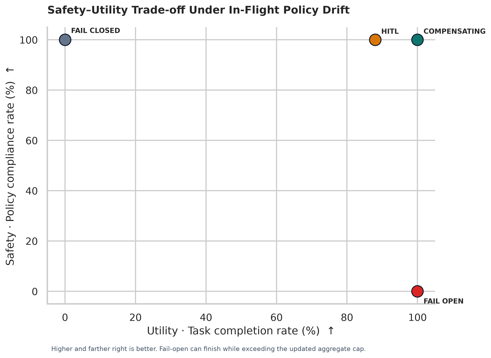
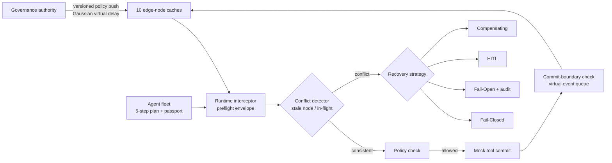

# AgentBridge: Runtime Policy-Version Consistency & Compensating Semantics for Autonomous Agent Fleets

AgentBridge is a pure Python 3.11+ in-memory discrete-event simulator for studying policy drift in autonomous-agent fleets. It models policy publication, asynchronous edge-node caches, pre-execution governance envelopes, in-flight session divergence, irreversible mock tool actions, and four recovery strategies. It has no Docker, broker, network service, or real external side effect; the Streamlit app is an optional local dashboard over the simulator.

## Research question and model

An agent executes an ordered plan \(\mathcal{A}=\langle a_1,\ldots,a_n\rangle\). A policy snapshot is \(P_v=\langle v,\mathcal{R}_v,h_v,\tau_v\rangle\), where `v` is a dotted numeric version, \(\mathcal{R}_v\) is a set of constraint rules, \(h_v\) is the first 16 hexadecimal characters of SHA-256 over canonical JSON of the version/domain/rules, and \(\tau_v\) is issuance time. Numeric values are normalized for hashing; issuance time is deliberately excluded. An envelope contains the node snapshot, a defensive snapshot of the agent passport and proposed action, and a deterministic integrity digest.

Two version conflicts are distinguished:

- **Stale-node drift:** the evaluating node's policy version or content hash differs from the current cluster head.
- **In-flight divergence:** the node matches the cluster head, but the agent passport remains pinned to a different initial policy version or hash.

The detector runs at both the action authorization and simulated commit boundary. The mock tool effect occurs only at commit, after policy checks. Already committed actions are never rolled back; in this benchmark the $450 flight is committed before the policy change. The simulator has one virtual clock (milliseconds), not independent physical node clocks, so clock skew is not modeled separately.

The propagation latency for each node is sampled as \(\delta_i=\max(10,\mathcal{N}(180,40))\) ms. A priority queue processes deliveries and uses insertion order for deterministic tie-breaking. The cluster head changes immediately on publication; each of the 10 edge nodes updates when its scheduled event arrives. Per-node generations prevent late, older deliveries from overwriting newer policy snapshots. No `sleep`, sockets, threads, or global random source are used.

### Recovery semantics

| Strategy | Runtime behavior |
| --- | --- |
| **Fail-Closed** | Stops at the first conflict before the next tool effect. Previously committed work remains committed. |
| **Fail-Open / Legacy Pinning** | Continues under the session's original policy, marks the passport `TAINTED`, and records an audit event. It does not compensate or silently switch to the new cap. |
| **HITL** | Uses a separate seeded approval draw (default probability 0.92) and adds 450 ms of modeled recovery overhead. A positive operator decision authorizes a revised, cap-compliant plan; denial fails closed. The approval probability is explicit and independent of network delay. |
| **Compensating Actions** | Preserves committed spend and allocates the remaining aggregate budget across future actions in plan order, clamping only future costs. Currency operations use `Decimal` and round down to cents. |

### Benchmark scenario and metric definitions

The five steps are: (1) zero-cost flight search, (2) irreversible $450 airfare charge, (3) zero-cost hotel-availability check, (4) irreversible $300 hotel reservation, and (5) zero-cost calendar invitations. The cluster publishes policy v2 immediately before step 3, reducing the **aggregate committed budget** from $1,000 to $650. Thus the remaining authorized lodging amount is $650 − $450 = $200. The plan's two zero-cost steps are still executed and required for a completed task.

- **Task completion rate (TCR):** percentage of trials in which all five actions commit.
- **Governance violation rate (GVR):** percentage of trials whose committed spend exceeds the final active policy cap.
- **Mean unauthorized cost:** mean of `max(0, committed spend − final cap)` per trial, in dollars. It is excess spend, not the total value of all violating actions.
- **Mean recovery latency:** modeled recovery overhead only; it excludes action duration and the 0.35 ms per-interception proxy overhead. Values are in milliseconds.

The fixed seed below intentionally makes the run reproducible. HITL is a Bernoulli sample with a 92% approval probability, not a forced 92 approvals. In this 100-trial sample it approves 88 trials; this is a sampling outcome, not a change in the configured probability. Other benchmark outcomes are deterministic for the given seed and event-order model.

## Observed benchmark results

Generated by `python -m evaluation.run_benchmarks --trials 100 --seed 20261108 --output-dir results` (400 trials total):

| Strategy | Trials | TCR | GVR | Mean unauthorized cost | Mean recovery latency | Mean committed spend |
| --- | ---: | ---: | ---: | ---: | ---: | ---: |
| Fail-Closed | 100 | 0.0% | 0.0% | $0.00 | 0.5 ms | $450.00 |
| Fail-Open | 100 | 100.0% | 100.0% | $100.00 | 0.2 ms | $750.00 |
| HITL | 100 | 88.0% | 0.0% | $0.00 | 450.0 ms | $626.00 |
| Compensating | 100 | 100.0% | 0.0% | $0.00 | 2.8 ms | $650.00 |

The observed 88% HITL task-completion value reflects the seeded 100-trial sample. Its configured approval probability is 92%; unlike the other strategy outcomes, the measured value is stochastic. The chart is calculated from the generated CSV and plots task completion against compliance (`100 − GVR`); a point farther up and right is preferable.



Benchmark outputs are in [`results/benchmark_raw_results.csv`](results/benchmark_raw_results.csv), [`results/benchmark_summary.csv`](results/benchmark_summary.csv), [`results/pareto_frontier.png`](results/pareto_frontier.png), and [`results/pareto_frontier.pdf`](results/pareto_frontier.pdf). The raw CSV has one row per trial and strategy, including seed, spend, completion, violation, latency, conflict type, and taint state.

## Architecture



### Repository layout

```text
agentbridge/
├── core/
│   ├── models.py              # Strict Pydantic models, enums, canonical hashes, envelopes
│   ├── policy_engine.py       # Policy authority, node cache, rule checks, contextual cache
│   ├── interceptor.py         # Sub-millisecond modeled request stamping and preflight
│   ├── conflict_detector.py   # Stale-node and in-flight divergence reports
│   └── recovery.py            # Four recovery handlers and shared budget clamp
├── simulation/
│   ├── network.py             # Priority-queue delivery and 10 edge nodes
│   ├── agent.py               # Session passport, plan state, mock endpoint commits
│   ├── environment.py         # Virtual-time orchestration and simulation results
│   └── mission_control.py     # Demo fleet, canary queue, shadow replay, HITL decisions
├── evaluation/
│   ├── scenarios.py           # $1,000 → $650 corporate travel scenario
│   ├── metrics.py             # TCR/GVR/spend/latency aggregation
│   └── run_benchmarks.py      # Seeded Monte Carlo CLI and CSV output
├── visualization/
│   ├── plot_results.py        # CSV-driven PNG/PDF Pareto chart
│   └── app.py                 # Interactive Streamlit workflow dashboard
├── tests/                     # Policy, conflict, recovery, mission-control, and end-to-end tests
├── results/                   # Generated benchmark CSVs and figures
├── requirements.txt
└── README.md
```

## Install and run

From the repository root:

```bash
python3.11 -m venv .venv
source .venv/bin/activate
python -m pip install --upgrade pip
python -m pip install -r requirements.txt

# Unit and end-to-end acceptance suite
pytest tests/ -v

# Default benchmark: 100 trials per strategy (400 total)
python -m evaluation.run_benchmarks --trials 100 --seed 20261108 --output-dir results

# Rebuild figures from the summary CSV
python -m visualization.plot_results results/benchmark_summary.csv --output-dir results

# Launch the interactive dashboard
python -m streamlit run visualization/app.py
```

The dashboard is organized into six mission-control areas: **Overview & Fleet Health**, **Live Agent Fleet**, **Execution Inspector**, **Policy Control Center**, **Quarantine & HITL**, and **Observability & Benchmarks**. The sidebar selects the simulated environment and recovery strategy and lets you explicitly run the five-step workflow; widget rerenders do not rerun it. The app bootstraps the repository root from its own file path, so its `core`, `evaluation`, and `simulation` imports also work when launched with an absolute script path.

### Mission-control coverage and data boundary

| Requested area | Implemented behavior |
| --- | --- |
| Overview and fleet health | Online/idle/halted counters, active policy adoption by edge node, divergence incidents, attention banner, aggregate token budget gauge, and fleet topology. |
| Fleet matrix | Agent/session/domain/status/version/consistency/taint columns, raw passport viewer, and in-memory Pause, Force Update, and Terminate actions. Updating a node does not rewrite the session's initial passport; any resulting in-flight mismatch remains visible. |
| Trace inspector | Step timeline, reversible/irreversible classification, proposed arguments, verdict, mock tool output, passport JSON, preflight/commit envelopes, digest validation, and rule violations. It shows concise operational plan notes, not hidden chain-of-thought. |
| Policy center | Rule builder with target-tool and parameter constraints, version diff, canary percentage, queued Gaussian-delay policy deliveries, manual virtual-time advance, rollout progress, and 500-session shadow replay. Canary and full-rollout controls stay disabled until a 500-session replay exists for the exact draft hash. |
| Quarantine and HITL | Escalation cards with one-time override, aggregate-budget compensation, and abort/freeze actions. Previously committed spend is never erased; an impossible retroactive correction is shown as residual excess. |
| Observability | TCR-versus-GVR chart, generated compliance Pareto figure, recovery/interceptor latency, propagation-delay histogram, and token-economy estimate. |

Mission Control is a deterministic demo console, not a connection to a real company fleet. Fleet records, incidents, audit entries, HITL items, and the 500-session replay archive are synthetic and session-local; canary controls advance a virtual clock. Prompt-to-policy history is illustrative (there is no LLM compiler call), and token savings are modeled estimates (model tokens are not instrumented). The UI stays in the repository's existing Streamlit/Python stack; the attached Next.js/Vite component hierarchy was treated as a suggested layout, not a required frontend migration.

### Windows PowerShell

Open PowerShell and change into the folder that contains `core`, `evaluation`, `simulation`, and `visualization` (the `agentbridge` folder), quoting the path if it contains spaces:

```powershell
cd "C:\path\to\agentbridge"
py -3.11 -m venv .venv
.\.venv\Scripts\Activate.ps1
python -m pip install -r requirements.txt
pytest tests/ -v
python -m evaluation.run_benchmarks --trials 100 --seed 20261108 --output-dir results
python -m visualization.plot_results results/benchmark_summary.csv --output-dir results
python -m streamlit run visualization/app.py
```

When launching the dashboard from a different working directory, pass the quoted full path to `visualization\app.py`; the app bootstraps the repository root before importing the project modules. The benchmark and plot module commands should be run from the repository root.

## Model and operational notes

- Each trial constructs fresh policies, agent passport, node caches, event queue, decision cache, and seeded RNGs. Benchmark strategies use common consecutive trial seeds for comparability.
- `PolicyEngine` decision-cache keys include the full policy identity and action/context, including committed execution history. Cache clearing occurs on publication and node updates.
- Context passports are strictly validated and taint cannot be reset from `TAINTED` to `CLEAN`. The `FAIL_OPEN` path cannot become trusted by later actions.
- Monetary values are stored and compared as `Decimal`; the scenario's ledger counts charges/reservations as committed costs when the mock action commits.
- The envelope signature is an unkeyed SHA-256 integrity digest for reproducible simulation traces. It is **not** a production authentication signature, authorization credential, or substitute for HMAC/signature keys, durable audit storage, or an external policy control plane.
- This code is a research simulator and dashboard, not a production enforcement proxy. Real deployments require authenticated transport, durable state, operator identity/approval workflows, cancellation semantics, retries/idempotency, clock-skew modeling, and explicit tool-specific compensation contracts.
